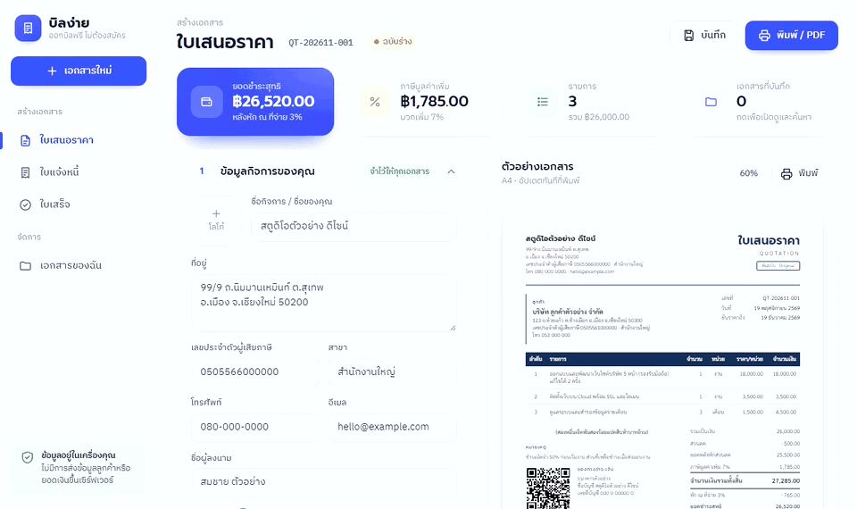
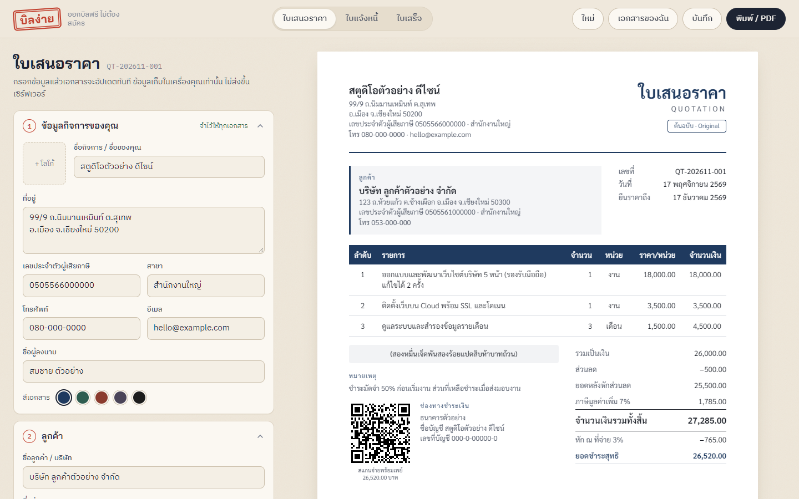

# บิลง่าย (BillNgai)

เว็บแอปทำ **ใบเสนอราคา ใบแจ้งหนี้ ใบเสร็จรับเงิน** ภาษาไทย ฟรี ไม่ต้องสมัคร
สำหรับฟรีแลนซ์และร้านค้าเล็ก ๆ ที่อยากได้เอกสารดูเป็นมืออาชีพภายในไม่กี่นาที





**ใช้งานจริง: https://shswsy.github.io/billngai/** · ดูตัวอย่าง: https://shswsy.github.io/billngai/?demo

ตัวอย่างไฟล์ PDF ที่ได้: [docs/sample-quotation.pdf](docs/sample-quotation.pdf)

## ทำอะไรได้บ้าง

- เอกสาร 3 แบบ: ใบเสนอราคา, ใบแจ้งหนี้ / ใบวางบิล, ใบเสร็จรับเงิน
- คำนวณ **VAT 7%** แบบบวกเพิ่มหรือรวมในราคา, **หัก ณ ที่จ่าย** 1/2/3/5%, ส่วนลด
- แปลงยอดเป็น **ตัวอักษรภาษาไทย** (เช่น "สองหมื่นเจ็ดพันสองร้อยแปดสิบห้าบาทถ้วน")
- **QR พร้อมเพย์** พร้อมยอดสุทธิ ลูกค้าสแกนจ่ายได้ทันที
- ใส่โลโก้ เลือกสีเอกสาร วันที่แบบ พ.ศ. เลขที่เอกสารรันอัตโนมัติ (QT-202611-001)
- พิมพ์หรือบันทึกเป็น **PDF ขนาด A4** (ฟอนต์ Sarabun) รองรับหลายหน้า
- เก็บประวัติเอกสาร ค้นหา และ **แปลงใบเสนอราคา → ใบแจ้งหนี้ → ใบเสร็จ** ได้ในคลิกเดียว
- สำรอง / นำเข้าข้อมูลเป็นไฟล์ JSON
- ใช้ได้ทั้งคอมและมือถือ รองรับโหมดมืด

## ความเป็นส่วนตัว

ไม่มีเซิร์ฟเวอร์หลังบ้าน ข้อมูลทั้งหมดเก็บใน `localStorage` ของเบราว์เซอร์ผู้ใช้เท่านั้น
ไม่มีการส่งข้อมูลลูกค้าหรือยอดเงินออกไปที่ใด

## เทคโนโลยี

React 19 · TypeScript · Vite · CSS ล้วน (ไม่ใช้ UI framework) · `qrcode` · Vitest
Deploy เป็น static site บน GitHub Pages ผ่าน GitHub Actions

โค้ดส่วนสำคัญ:

| ไฟล์ | หน้าที่ |
| --- | --- |
| `src/lib/bahtText.ts` | แปลงตัวเลขเป็นคำอ่านบาท (เหมือน `BAHTTEXT` ของ Excel) |
| `src/lib/promptpay.ts` | สร้าง payload QR พร้อมเพย์ตามมาตรฐาน EMVCo + CRC16 |
| `src/lib/calc.ts` | คำนวณยอด ส่วนลด VAT และภาษีหัก ณ ที่จ่าย |
| `src/lib/storage.ts` | บันทึก/รันเลขเอกสาร/แปลงประเภท/สำรองข้อมูล |
| `src/components/Paper.tsx` | หน้าเอกสาร A4 ที่ใช้ทั้งแสดงผลและพิมพ์ |

## รันในเครื่อง

```bash
npm install
npm run dev      # http://localhost:5173
npm test         # unit tests (ตัวอักษรบาท, พร้อมเพย์, การคำนวณภาษี)
npm run build    # ไฟล์ static อยู่ใน dist/
```

เปิด `/?demo` เพื่อดูเอกสารตัวอย่าง (ใช้ได้เฉพาะเครื่องที่ยังไม่เคยบันทึกข้อมูล)
